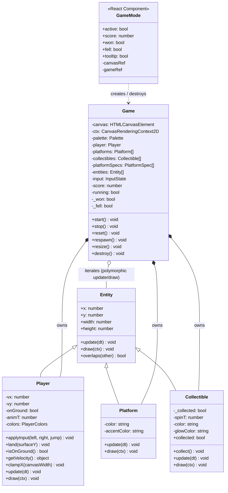

# Game Mode

A small canvas-based collect-the-items platformer overlaid on the portfolio. Its purpose is to demonstrate classic OOP patterns — inheritance, polymorphism, and encapsulation — in a self-contained, zero-dependency module.

---

## Class diagram



---

## How platforms are derived from the DOM

### Why DOM-derived platforms?

The portfolio has multiple pages and sections at different scroll depths. Rather than hard-coding platform coordinates, the game reads the live layout at runtime, making the level automatically match whatever page the user is on.

### The algorithm

1. **Query** `document.querySelectorAll("h1, h2, h3, button, a[role='button'], a[class*='btn'], img, [class*='card'], [class*='project'], [class*='panel']")` — targets visible, content-bearing elements that have meaningful width and height, without touching `section` elements (which span whole areas and would create platforms at unhelpful positions).

2. **Filter** each element:
   - `!el.offsetParent` → hidden (display:none or detached); skip.
   - `getComputedStyle(el).position === 'fixed' | 'sticky'` → not part of the scroll flow; skip.
   - `rect.width < 60 || rect.height < 20` → too small for a useful landing surface; skip.
   - Clamp platform x/width to canvas bounds.
   - **Y-dedup**: if another platform already exists within 30 px in document-y, skip (prevents clusters on closely-spaced elements like heading + subheading).

3. **Coordinate conversion** — `rect.top + window.scrollY` converts viewport-relative `getBoundingClientRect()` output into document-space y. This is the y stored in `PlatformSpec` and used for the `Platform` entity.

4. **Cap** at 40 DOM-derived platforms so the entity list stays manageable.

5. **Gap filling** — after sorting specs by y, consecutive pairs are checked. If the gap between upper and lower platform exceeds `MAX_JUMP_HEIGHT × 0.8 ≈ 77 px`, one or more stepping platforms are auto-inserted. Step y is spaced at `gap_threshold × 0.9` intervals; x and width are randomised within 15–75 % of canvas width. This guarantees every section is reachable without requiring the player to know the exact jump height.

6. **Collectible placement** — the document height is divided into 5 equal bands. One platform from each band is chosen (DOM-derived preferred over gap-fills). If no platform exists in a band, `console.warn` fires. The 5 `Collectible` entities are placed 22 px above their chosen platform's top edge.

### When platforms are rebuilt

| Trigger | Mechanism |
|---|---|
| Game activated | `rebuildPlatforms()` called in constructor |
| Canvas resize (window resize or DPR change) | `ResizeObserver` on the container div → `Game.resize()` → debounced 100 ms |
| Layout shifts (font load, image decode) | `document.fonts.ready` promise + `window` `load` event → debounced rebuild |
| Ongoing layout changes | `ResizeObserver` on `document.body` → debounced 100 ms |

**All layout reads are outside the rAF loop.** The loop only reads `window.scrollY` (a cheap compositor value) for the translate step.

### Player snap on rebuild

If a rebuild occurs while the player is standing on a platform (i.e., `isOnGround() === true`), `snapPlayerToGround()` checks if the player still overlaps any platform after the rebuild and calls `player.land(plat.y)` to keep them on the new surface. This prevents the player from floating in air after a font-load reflow.

---

## Full-page coordinate system

The canvas is `position: fixed`, `100vw × 100vh` — it never changes size with the document. Entity `y` values are stored in **document space** (absolute pixels from the top of the page). The draw step applies:

```ts
ctx.save();
ctx.translate(0, -window.scrollY);
// ... draw all entities ...
ctx.restore();
```

This means a `Platform` at document-y 800 is drawn at viewport-y `800 - scrollY`. When the user scrolls down 800 px, it appears at the very top of the screen — exactly correct.

---

## Camera follow

`cameraFollow()` runs once per frame inside `update()`. It keeps the player inside a `[20 %, 70 %]` dead-zone of `window.innerHeight`:

```ts
const playerViewY = player.y - window.scrollY;
const delta = /* distance outside zone */;
const nudge = delta * 0.12;   // lerp — proportional to distance
window.scrollBy({ top: nudge, behavior: "auto" });
```

To avoid fighting user-initiated scrolling, the method records `lastGameScrollTime` on every `scrollBy` call and reads `lastScrollEventTime` (updated by a passive `scroll` listener). If a scroll event arrived after the last game-initiated scroll and less than 200 ms ago, camera follow is suppressed for that frame.

---

## Fall detection

If `player.y > window.scrollY + window.innerHeight + 200` — more than 200 px below the visible viewport bottom — `_fell` is set to `true`, the loop stops, and `onFell()` notifies React. The threshold of 200 px gives enough slack for normal drops (a full jump arc below the screen) without false positives.

"Try again" calls `Game.respawn()`: the player is teleported back above the first platform but the score is kept. "Reset all" calls `Game.reset()` which also clears the score and re-randomises gap-fill stepping platforms.

---

## Design decisions

### 1. Inheritance — `Entity` as the base contract

All drawable game objects extend `Entity`. The abstract `update(dt)` and `draw(ctx)` methods form the **polymorphic interface**: the `Game` loop iterates `this.entities: Entity[]` and calls both without ever inspecting the concrete type.

### 2. Encapsulation

Physics state (`vx`, `vy`, `onGround`) inside `Player` is **private**. The `Game` drives the player through three narrow public methods: `applyInput`, `land`, `getVelocity`. `Collectible` exposes only `collect()` and the read-only `collected` getter.

### 3. Composition over inheritance in `Game`

`Game` holds arrays of entities (composition) and orchestrates them. Entities know how to draw/update themselves; `Game` knows when to call them and how to resolve cross-entity interactions.

### 4. Separation of logic from React

Entity classes and `Game` are **plain TypeScript with zero React imports**. `GameMode.tsx` is the only React file; it creates/destroys a `Game` in response to the toggle and passes callbacks (`onScoreChange`, `onWin`, `onFell`) to push state up to React.

### 5. SSR safety

`GameMode` uses `useSyncExternalStore` with `getServerSnapshot → null`. No `window`/`document`/`canvas` access happens during server render. `Game` constructor is only ever called client-side, inside a `useEffect`.

### 6. Accessibility

- `pointer-events: none` on canvas — page remains fully interactive.
- `(pointer: coarse)` / `prefers-reduced-motion` → component renders `null`.
- `document.visibilitychange` → loop pauses when tab is hidden.
- `aria-pressed` on toggle, `aria-live` on score counter and overlays.
- `aria-expanded` on the `(i)` button.
- Keys ignored when focus is in `input`/`textarea`/`select`/`contenteditable` or when Ctrl/Cmd/Alt is held.
- `preventDefault` only while game is active and not in won/fell state; never `stopPropagation`.

---

## Files

| File | Role |
|---|---|
| `src/components/game/entities/Entity.ts` | Abstract base class |
| `src/components/game/entities/Player.ts` | Movement + gravity |
| `src/components/game/entities/Platform.ts` | Static surface |
| `src/components/game/entities/Collectible.ts` | Spinning gem |
| `src/components/game/Game.ts` | Loop, DOM platform builder, input, collision, camera, score |
| `src/components/game/GameMode.tsx` | React mount point (client only) |
| `src/app/layout.tsx` | **Modified** — one import + `<GameMode />` |
