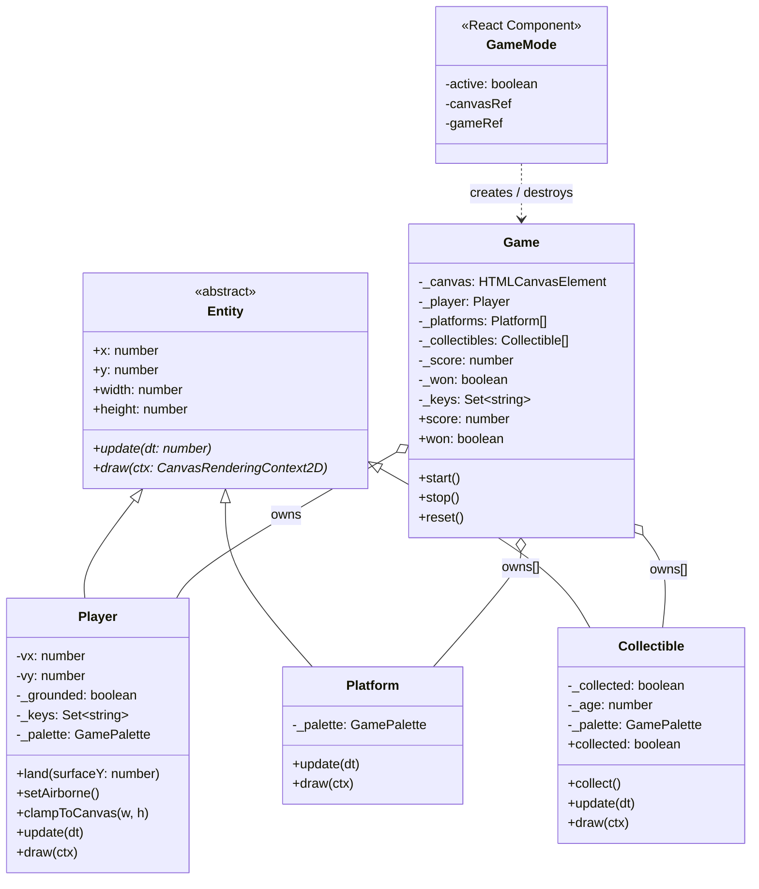

# Game Mode

An optional canvas-based mini-platformer layered over the portfolio page.
It is off by default; a **GAME MODE** button in the bottom-right corner activates it.

## How to play

| Key | Action |
|---|---|
| `←` / `A` | Move left |
| `→` / `D` | Move right |
| `↑` / `W` / `Space` | Jump |
| `R` | Reset (after winning) |

Collect all 5 diamonds to win. The player resets to the top if they fall off the bottom.

---

## Class diagram

---

## Design decisions

### 1. Inheritance for type identity, composition for the game loop

`Entity` is abstract and declares only `update()` and `draw()` — the minimum contract.
`Game` holds three separate arrays (`_player`, `_platforms[]`, `_collectibles[]`) and
calls `update()`/`draw()` on each, demonstrating polymorphism: the loop doesn't need to
know whether it's updating a `Player` or a `Collectible`.

`Game` itself is **not** an `Entity` — it owns entities (composition) rather than being one.

### 2. Encapsulation via private fields

All mutable state that external callers shouldn't touch uses TypeScript `private`.
Public surface is intentionally minimal:

- `Player` exposes `land()`, `setAirborne()`, `clampToCanvas()` — verbs, not raw fields.
- `Collectible` exposes only `collect()` and the read-only `collected` getter.
- `Game` exposes `start()`, `stop()`, `reset()`, `score`, `won`, `total`.

### 3. React stays out of game logic

`GameMode.tsx` is the only file with React imports. It is a thin shell that:

1. Reads `prefers-reduced-motion` and `pointer: coarse` to gate the feature.
2. Creates a `<canvas>` with `pointer-events: none` (never blocks the real page).
3. Constructs a `Game`, calls `start()`, and returns a cleanup that calls `stop()`.

The game classes are plain TypeScript with no framework coupling — they could run
in a Node test harness or a different framework without changes.

### 4. SSR safety

`GameMode.tsx` is annotated `"use client"`. All `window`/`document` access lives inside
`useEffect`, which Next.js never runs on the server. The component returns `null` until
the client-side check confirms the browser supports the feature.

### 5. Color palette

Colors are read from the document's computed CSS custom properties at `Game` construction
time (`--color-ink`, `--color-signal`, `--color-paper`), so the game automatically
respects the light/dark theme the user has active.

### 6. Accessibility

- The canvas has `aria-hidden="true"` — screen readers ignore it entirely.
- The toggle button has a descriptive `aria-label` that changes with state.
- The whole feature is suppressed when `prefers-reduced-motion: reduce` is set.
- Touch/mobile devices never see the button (canvas input requires a keyboard).
