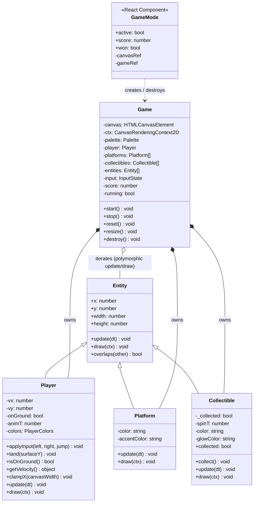

# Game Mode

A small canvas-based collect-the-items platformer overlaid on the portfolio's hero viewport. Its purpose is to demonstrate classic OOP patterns — inheritance, polymorphism, and encapsulation — in a self-contained, zero-dependency module.

---

## Class diagram

---

## Design decisions

### 1. Inheritance — `Entity` as the base contract

All drawable game objects extend `Entity`. The abstract `update(dt)` and `draw(ctx)` methods form the **polymorphic interface**: the `Game` loop iterates `this.entities: Entity[]` and calls both methods on every element without ever inspecting the concrete type. Adding a new object (e.g. a moving enemy) requires only a new subclass — the loop needs no changes.

### 2. Encapsulation

Physics state (`vx`, `vy`, `onGround`) inside `Player` is **private**. The `Game` drives the player through three narrow public methods:

- `applyInput(left, right, jump)` — translates key state into velocity
- `land(surfaceY)` — called after collision resolution; the player cannot falsely self-report landing
- `getVelocity()` — read-only access needed for the collision look-ahead

`Collectible` exposes only `collect()` and the read-only getter `collected`; the spin timer is fully private.

### 3. Composition over inheritance in `Game`

`Game` does **not** extend anything. It owns arrays of entities (composition) and orchestrates them. This keeps responsibilities clear: entities know how to draw/update themselves; `Game` knows when to call them and how to resolve cross-entity interactions (collision, pickup).

### 4. Separation of logic from React

`Entity`, `Player`, `Platform`, `Collectible`, and `Game` are **plain TypeScript classes** with zero React imports. `GameMode.tsx` is the only React file; it creates and destroys a `Game` instance in response to the toggle, and passes two callbacks (`onScoreChange`, `onWin`) so the game can push state up to React without the game depending on React.

### 5. SSR safety

`GameMode` returns `null` until mounted (`useGameAvailable` sets `available` in `useEffect`). No `window`/`document`/`canvas` access happens during the server render. The `Game` constructor is only ever called client-side, inside a `useEffect`.

### 6. Accessibility constraints honoured

- **`pointer-events: none`** on the canvas — the page remains fully interactive.
- **`(pointer: coarse)`** — game mode button is not rendered on touch screens.
- **`prefers-reduced-motion`** — game mode button is not rendered when the user has requested reduced motion.
- **`document.visibilitychange`** — the animation loop is paused when the tab is hidden.
- **`aria-pressed`** on the toggle, **`aria-live`** on the score counter and win overlay.

### 7. Canvas scope

The canvas and win overlay use `height: 100dvh; bottom: auto` so gameplay is confined to the first viewport (hero area). Platforms and collectibles are positioned as fractions of `canvas.width / canvas.height` and recomputed on every `resize()` call, so the layout adapts correctly to DPR changes and window resizes.

---

## Files

| File | Role |
|---|---|
| `src/components/game/entities/Entity.ts` | Abstract base class |
| `src/components/game/entities/Player.ts` | Movement + gravity |
| `src/components/game/entities/Platform.ts` | Static surface |
| `src/components/game/entities/Collectible.ts` | Spinning gem |
| `src/components/game/Game.ts` | Loop, input, collision, score |
| `src/components/game/GameMode.tsx` | React mount point (client only) |
| `src/app/layout.tsx` | **Modified** — one import + `<GameMode />` |
